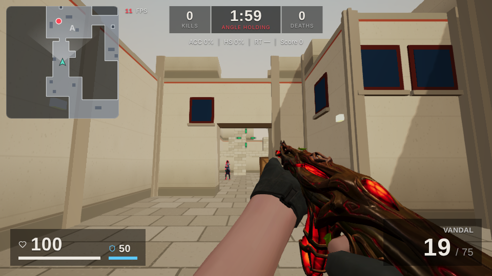

# Tactical Aim Lab

A browser-based 3D aim-practice lab inspired by Valorant. Open it in Chrome, pick a map and a spot to hold, set your sensitivity and crosshair, choose a weapon and fight AI bots that peek, swing, spray and reposition the way real players do. No install, no account: everything runs in the page.



It's a free, non-commercial fan project and isn't affiliated with Riot Games. The maps, guns, sounds and fallback bots are original and generated at runtime. Some optional models are community fan art under CC BY 4.0 (credits at the end and in `public/models/README.md`).

---

## 1. What we're trying to build

Most aim trainers drill clicking on dots. In a real Valorant round the hard part is different: you hold an angle, an enemy jiggles to bait your shot, shoulder-peeks, swings wide or sprays from a crouch, and you have to react with the right crosshair placement, a counter-strafe and a controlled first bullet. **The goal of Tactical Aim Lab is to recreate those duels** so they can be practised over and over, measured, and improved.

What that means in practice:

- **Bots that play like people.** The bots are the core of the project. They hide behind real cover, peek in different styles (jiggle, shoulder bait, wide swing, crouch spray, ADAD), have human reaction times and aim error, stop before shooting, control recoil, take cover when hurt and re-peek.
- **The game feel has to match.** The sensitivity scale is Valorant's (0.07° per mouse count), movement speeds, counter-strafing, first-shot accuracy, running inaccuracy and spray patterns follow the same rules, so practice carries over.
- **Real locations.** Eight original maps are laid out like the competitive maps they're inspired by, each with practice locations (A Main, Mid, B Long…), attack and defend spawns, and enemy positions that are proven to be peekable.
- **Measurable progress.** Every shot is recorded: accuracy, headshot rate, reaction time, time to kill, first-shot versus spray accuracy, per-weapon results, with a report after each session and charts over days and weeks.
- **Runs anywhere a browser runs.** No download, no anti-cheat, no game client. It can even be built into one self-contained HTML file.
- **Clean assets.** Nothing is extracted from the game. Geometry, textures and sounds are made in code; optional models are licensed community work, and recordings are only ones the owner has the rights to.

## 2. Run it

```bash
npm install          # or: bun install
npm run dev          # http://localhost:5173
npm run build        # typecheck + production build into dist/
npm run build:single # one self-contained HTML file in dist-single/ (no models or recordings)
npm run preview      # serve the production build
npm run typecheck    # tsc --noEmit
npm test             # unit and map tests (vitest)
```

Headless gameplay smoke tests (Chromium with SwiftShader; Playwright installed globally):

```bash
npm run build && npx vite preview --port 4173 &
node scripts/e2e.mjs http://localhost:4173/ e2e-shots          # movement, aiming, shooting, bots, reload
MAPS='[{"id":"vellora","locations":["a-main","mid","b-main"]}]' \
  node scripts/e2e-maps.mjs http://localhost:4173/ e2e-maps    # every listed map/location peeks correctly
```

### Controls

| Action                                                      | Key                               |
| ----------------------------------------------------------- | --------------------------------- |
| Move                                                        | W A S D (or arrow keys)           |
| Walk                                                        | Shift                             |
| Crouch                                                      | Ctrl or C                         |
| Jump                                                        | Space                             |
| Fire                                                        | Left mouse                        |
| Aim down sights (rifles, Sheriff) / 3-round burst (Classic) | Right mouse                       |
| Reload                                                      | R                                 |
| Primary / sidearm                                           | 1 / 2, or the mouse wheel to swap |
| Weapon menu (change primary and sidearm mid-session)        | B                                 |
| Pause                                                       | Esc                               |

## 3. How it's built

### 3.1 Stack

- **Babylon.js 9** renders the world: camera, PBR and standard materials, shadows, particles, glTF models. It is imported by deep paths (`src/game/rendering/babylon.ts`) so the bundle only contains what is used.
- **TypeScript** everywhere, strict mode.
- **React 19 + Vite 8 + Tailwind CSS 4 + Lucide** for the menus, settings, HUD and reports.
- **Web Audio API** for all sound, with HRTF 3D panning.
- **Pointer Lock API** with `unadjustedMovement` (raw mouse input).
- **localStorage** for settings, crosshair presets and session history.
- **Vitest** for unit and map tests, **Playwright** scripts for in-browser smoke tests.

There are no other runtime dependencies: physics, AI, navigation, audio synthesis and the map builder are all written for this project.

### 3.2 Project layout

```
src/
  app/App.tsx                 shell + navigation
  pages/                      Home, Practice, Maps, Weapons, Crosshair, Sensitivity, Statistics, Settings, Game
  components/                 UI kit, MapPreview (top-down SVG with live field of view), charts, HUD, session report
  hooks/useAppStore.ts        small external store (useSyncExternalStore) with persistence
  services/storage.ts         versioned localStorage with defaults merging
  settings/defaults.ts        default settings, difficulty presets, graphics presets, eDPI / cm-per-360 maths
  types/                      shared interfaces (weapon, bot, map, practice, crosshair, sensitivity, stats, HUD)
  game/
    engine/GameEngine.ts      the only React↔game boundary: create/start/pause/end/updateSettings + events
    engine/RenderHost.ts      one Babylon engine + canvas reused by every session
    core/Input.ts             keyboard/mouse, pointer lock, raw deltas consumed once per frame
    physics/CollisionWorld.ts AABB world: slab raycasts, kinematic movement, hitboxes
    player/PlayerController   look, run/walk/crouch/jump, counter-strafe friction
    weapons/                  weapon configs + recoil patterns, WeaponSystem, ViewModel, skins, three kinds of arms
    bots/                     Bot entity, visuals, behaviours, perception, navigation
    maps/                     grid map definitions, map builder, enemy-spot finder, generated spots
    practice/                 PracticeDirector (modes, spawns, respawns), SessionTracker (stats + scoring)
    rendering/                MapRenderer, procedural textures, pooled effects, glTF helpers
    audio/                    AudioEngine (playback, 3D, recordings) and gunSynth (synthesised gunshots)
    hud/                      crosshair renderer (shared with the editor) and minimap
public/
  favicon.svg                 crosshair icon (inlined as a data URI in the single-file build)
  models/                     agent, arms and weapon-skin GLBs with their credits (README.md)
  sounds/                     recordings that replace synthesised sounds (README.md lists the slots)
docs/screenshots/             images used in this README
scripts/                      single-file build, Playwright smoke tests, asset preparation
tests/                        unit and map tests; tests/tools/gen-spots.test.ts regenerates enemy spots
```

### 3.3 The frame loop and the React boundary

React never drives the game. `GameEngine` owns a `requestAnimationFrame` loop:

1. **Mouse look first.** Raw mouse deltas are applied to the camera before anything else, so aiming has the lowest possible latency.
2. **Fixed 120 Hz simulation.** The player, weapons, bots and practice director advance in fixed substeps, so fire rates, movement and AI timing don't depend on the frame rate.
3. **Render.** Babylon draws the scene; the crosshair, hit markers, damage-direction arcs and minimap are drawn every frame onto a 2D overlay canvas.

React only receives throttled HUD snapshots (about 12 per second) and discrete events (kill feed, status changes, session end). The engine and canvas are created once (`RenderHost`) and reused by every session, and compiled shaders are kept (`Effect.PersistentMode`), so only the first session pays the shader-compile cost. A session can be torn down while it's still loading, which keeps React StrictMode's double mount from building two engines.

### 3.4 Player movement and aiming

- `PlayerController` models acceleration and friction rather than instant velocity. Running speed is 5.85 m/s; walking and crouching scale from it. Releasing a key applies a strong counter-strafe friction, so stopping from full speed to "accurate" speed takes under 80 ms (unit test).
- The player is an upright box moved kinematically against the map's merged boxes (`CollisionWorld`): wall sliding, 0.4 m step-up, ground snapping on stairs, and a ceiling check before standing up from a crouch.
- Look uses Valorant's scale (sensitivity × 0.07° per count), with separate horizontal, vertical and ADS multipliers and invert Y. The Sensitivity page converts from other games and shows eDPI and cm/360°.

### 3.5 Weapons

- Eight weapons live in `src/game/weapons/weaponConfigs.ts`. Primaries: Vandal (9.75 rounds/s, 25 rounds, 160/40/34 head/body/legs at every range), Phantom (11 rounds/s, 30 rounds, suppressed, damage falls off at 15 m and 30 m), Spectre (suppressed SMG, 13.33 rounds/s, accurate on the move), Guardian (semi-automatic, 195/65/49) and Operator (bolt-action sniper, 255/150/120, 2.5× scope, only accurate scoped and still). Sidearms: Classic (right-click burst), Ghost (suppressed, 15 rounds) and Sheriff. The Operator's scope is drawn on the 2D overlay and uses the scoped-sensitivity multiplier.
- `WeaponSystem` handles firing on a carried sub-frame cooldown (so the fire rate is exact at any frame rate), spread (base, crouch, running, in the air, and firing error that grows per shot), hand-authored recoil patterns with recovery, ADS (1.25× zoom), bursts, reloads, auto-reload and equip times.
- Shots are hitscan: a ray from the eye through the spread cone is tested against the world and each bot's hitboxes (head, body, legs, following crouch). The closest hit wins, so walls stop bullets.
- Reload times match Valorant's (Classic 1.75 s, Ghost 1.5 s, Sheriff 2.25 s, Spectre 2.25 s, Guardian, Phantom and Vandal 2.5 s, Operator 3.7 s). The reload animation and its sound cues last the whole reload, ending as the gun can fire again.
- **Weapon menu.** B pauses the session and opens a menu of every primary and sidearm; picking one swaps it into its slot with a full magazine (`GameEngine.setWeapon`, loading the gun's model on demand), and B again returns to the fight. The choice becomes the default loadout for the next session.
- **Gun models.** The Vandal, Phantom and Sheriff can use skin GLBs. Each is placed from grip, handguard, muzzle and sight points measured on the model, so the hands, muzzle flash, tracers and sights line up. The Classic, Ghost, Spectre, Guardian and Operator use models of real-world firearms (a USP, a suppressed G23, an MP5SD, an SVD and a modern sniper rifle). The "simple guns" setting and the single-file build use guns built from boxes in `ViewModel.ts`.
- **First-person arms** (Settings → Graphics → First-person arms):
  - _Animated_ (default): an animation pack of gloved arms. `AnimatedArms.ts` evaluates its Draw, Fire, Reload and Reload_Empty clips from game state every frame; the game's gun rides the pack's weapon joint and the magazine follows the pack's magazine joints. The rig is turned so the barrel points at the crosshair, and ADS blends the rig to centre the sights. Pistols have no clips, so the arms are solved onto the pistol with two-bone IK.
  - _Rigged arms_: a static arm model that `ArmModel.ts` cuts up and skins in code at load (forearm, hand and finger bones), then poses with IK every frame.
  - _Simple_: block hands. The single-file build uses arms built from simple shapes.
- Effects: muzzle flash with a light, tracers (not on the suppressed Phantom), wall decals, sparks, hit puffs and view kick, all from pooled objects (`rendering/Effects.ts`).

### 3.6 Bots

A bot is one `Bot` entity (state, perception, aim, shooting, movement) plus a _behaviour_ that decides what it wants to do, plus a _visual_.

- **Perception** (`bots/perception/visibility.ts`): a ~130° field of view and line of sight tested with raycasts to seven points on the body (head, both cheeks, chest, both shoulders, legs), so bots can't see or shoot through walls but do spot a shoulder or head poking out. The same code analyses each peek line to find where a bot is hidden and where it becomes visible.
- **Aim model**: a reaction delay after the player becomes visible (650 / 420 / 270 / 175 ms for Easy / Normal / Hard / Radiant), an aim error that starts wide and converges, a head-or-body choice, bursts with pauses so recoil resets, recoil compensation, and a stop before shooting (counter-strafe discipline). Headshot chance (how often a bot aims for the head; at 0 bots deal no headshot damage) and a bot damage multiplier are set per difficulty and can be changed on the Practice page. Custom sliders cover reaction, accuracy, peek frequency and duration, speed, aggression, burst length and crouch frequency.
- **Peek behaviour** (`behaviors/PeekBehavior.ts`, used in Angle Holding and Jiggle training): a state machine (hidden → prep → out → hold/engage → back, with relocation to another free spot) that plays full peeks, jiggles, shoulder baits, wide swings, crouch sprays and ADAD strafes.
- **Deathmatch behaviour**: patrols or hunts the player, hears gunfire and footsteps, chases the last known position, takes cover when low on health and re-peeks. Paths come from grid A\* (`navigation/`) with step heights, drops, corner rules and path smoothing.
- **Weapons and fairness**: each bot draws a gun when it spawns (Practice → Bot weapons: a weighted mix of every gun but the sniper, rifles only, sidearms only, or your own primary) and taps semi-automatic guns in ones and twos. `maxAttackers` limits how many bots may shoot at once (1 / 2 / 3 / no limit for Easy / Normal / Hard / Radiant); the others hold fire until a slot frees up. Bots hold fire for a moment after you respawn (2 s in Deathmatch).
- **Size**: bots are person-sized (1.8 m). One constant, `BOT_SCALE` in `visibility.ts`, scales the model, hitboxes, collision, eye height and visibility checks together; regenerate enemy spots after changing it.
- **Visuals**: by default a rigged agent model with no animations, posed in code every frame (crouch, walk cycle with foot IK, aim pitch, both hands IK-solved onto the rifle). Posing is skipped off-screen and runs at a third of the rate far away. The fallback is a procedural training dummy. Both have an enemy highlight.

### 3.7 Maps

- Maps are written as **character grids** (`src/game/maps/<theme>/<map>.ts`) with a small builder (`GridBuilder`): `#` wall, `.` floor, `c`/`C`/`D` low crate, crate and stack, `P` pillar, `r` rail, `=` arch, `w` window, and digits for raised floors. Each cell is 1.5 m (`CELL` in `GridMap.ts`).
- `MapData` turns the grid into **merged boxes** once, and the same boxes feed rendering, collision and navigation, so what you see is what blocks you. Corridors are then dressed deterministically: stepped wall heights, archways and low crates in long corridors (real geometry), and visual-only facade detail (doors, windows, lamps, pilasters).
- Each map declares practice **locations** with attack and defend spawns. Vellora's enemy spots are placed by hand. For the other seven, `spotFinder.ts` scans every cover face and keeps positions where a bot is fully hidden, becomes visible after a short strafe, and stands in front of the player; it tops up the picks until every spawn has at least 3 usable spots (the map test checks this) and stores them in `src/game/maps/generated/*.json`. Regenerate after changing geometry, spawns or bot size:

  ```bash
  GEN_SPOTS=1 npx vitest run tests/tools/gen-spots.test.ts
  ```

| Map        | Inspired by | Practice locations                                                     |
| ---------- | ----------- | ---------------------------------------------------------------------- |
| Vellora    | Ascent      | A Main, Mid, B Main                                                    |
| Dunehold   | Bind        | A Short (via Showers), A Long, Hookah (door + window), B Long          |
| Sanctum    | Haven       | A Long, A Short, Mid, Garage, C Long (three sites)                     |
| Kitsune    | Split       | A Main (under A Heaven), Mid (raised Mid Top), B Main (under B Heaven) |
| Tamarind   | Lotus       | A Main, B Main, C Main over the C Mound (three sites)                  |
| Permafrost | Icebox      | A Main, Mid (Boiler), B Main into container mazes                      |
| Coralis    | Breeze      | A Main into a huge open site, Mid, B Main through the B Elbow          |
| Goldline   | Sunset      | A Main via the A Elbow, Mid (Market/Courtyard), B Main                 |

### 3.8 Practice modes and statistics

- **Angle Holding**: hold a location while bots peek with the behaviour you pick (or a mix). Bots that peek and escape count against you.
- **Jiggle Peek Training**: bots jiggle, shoulder-bait and then commit; wasted bait shots are tracked.
- **Basic Deathmatch**: up to 10 bots that roam, hunt and respawn.
- **Spray Control**: no bots. Spray at any wall and pull against the recoil. `SprayTrainer` groups shots into sprays (five bullets or more) and scores each from 0 (mouse held still) to 100 (recoil fully cancelled) by how far the centre of the spread cone (aim movement plus recoil pattern) strays from the first-shot point; random spread is plotted but not scored. A panel on the 2D overlay plots the bullets, your control line and the uncontrolled pattern live.

`PracticeDirector` owns the bots, assigns spots (never one whose peek line passes within 6 m of your spawn), handles deaths and respawns. `SessionTracker` records shots, hits by zone, reaction time (bot visible → your first hit), time to kill, first-shot / spray / moving accuracy, kills, deaths, damage, escapes, bait shots and a per-weapon breakdown, and computes a score. Each session ends with a report; history (up to 300 sessions) feeds the Statistics page's daily and weekly charts.

### 3.9 Rendering

- `MapRenderer` batches the merged boxes into a few meshes with world-space UVs, so textures tile evenly at any box size. Wall, floor, crate, metal and stone textures and the sky are drawn procedurally on canvases (`rendering/textures.ts`), seeded per map.
- Graphics presets (Potato / Low / Medium / High) set shadows, resolution scale, anti-aliasing, effects, post-processing, lighting, texture size and which bot, gun and arm models load. Potato is for machines without a dedicated GPU. On first run `settings/deviceProfile.ts` reads the GPU name and picks a preset; Settings shows what it found.
- Adaptive resolution (on by default) lowers the render scale in steps while the frame rate is under 60 (or the FPS limit) and raises it again afterwards, down to half the chosen scale. An FPS limit (30 / 60 / 120 / 144) is available for laptops.
- The game page and Babylon load on demand, so the menus don't download the 3D engine; it is fetched in the background once the page is idle.
- WebGPU can be chosen in Settings and falls back to WebGL 2.
- The minimap is pre-rendered from the grid and rotated so your facing is up; nearby enemies are shown as a training aid (range adjustable).

### 3.10 Audio

- `gunSynth.ts` builds each gunshot from layers (supersonic crack, muzzle blast, body punch, sub thump, mechanical action, early reflections, convolution reverb) and renders 4 variations per weapon with an `OfflineAudioContext`.
- `AudioEngine.ts` plays everything: footsteps, jumps, landings, reload cues, hit and headshot sounds, kill-streak chimes, bullet whizz. Enemy sounds are positioned in 3D (HRTF), muffled with distance and behind walls, and sent to a reverb; enemy gunshots use the same clean sound as your own gun, only panned and slightly quieter with distance.
- Any slot can be replaced by recordings listed in `public/sounds/manifest.json` (see `public/sounds/README.md`). Recordings are trimmed of silence on load, long footstep takes are cut into single steps, and footsteps, reloads and kill sounds play one voice at a time. In this repository the Vandal, Phantom and Sheriff shots, footsteps, the reload and kill-streak sounds 1–5 use the owner's recordings. The Classic, Ghost, Spectre, Guardian and Operator shots are real firearm recordings from the CC0 Free Firearm Sound Library (`scripts/extract-firearm-library.py`). Everything else is synthesised.

### 3.11 UI, settings and storage

- Pages: Home, Practice (map, location, side, spawn, mode, behaviour, bot count, difficulty, weapons), Maps, Weapons, Crosshair (full editor with presets and import/export codes), Sensitivity, Statistics, Settings (graphics, audio, HUD, controls, data) and Game.
- Settings live in a small external store (`useAppStore`) saved to versioned localStorage keys; stored values are merged with the defaults so new settings appear without wiping old ones.
- Robustness: the game pauses on Esc, pointer-lock loss, window blur or a hidden tab; pointer lock is requested before fullscreen; WebGL context loss and missing WebGL show a clear message; audio starts on the first click; fullscreen uses Keyboard Lock so Ctrl+W doesn't close the tab while crouch-walking.

### 3.12 Builds and assets

- `npm run build` produces `dist/` for any static host (the project deploys to Vercel).
- `npm run build:single` builds with `vite.single.config.ts` and inlines all JS, CSS and the favicon into one HTML file. That build sets `__LOCAL_MODELS__` to false, so it never loads GLB models or recordings: bots are training dummies, arms are built from shapes and all sounds are synthesised.
- `scripts/compress-models.mjs` shrinks every GLB in `public/models` (welding, quantized vertex data, trimmed animation keyframes, a lighter Phantom): 7.0 MB → 3.9 MB.
- Model preparation is scripted: `scripts/prepare-agent-model.mjs` and `scripts/prepare-fp-arms.mjs` (glTF-Transform), and `scripts/extract-gun-samples.py` cuts single shots out of longer recordings.

### 3.13 Testing and debugging

- `npm test` checks the collision world, hitboxes, weapons (fire rate at any step size, first-shot accuracy, spray climb, recoil recovery, running inaccuracy and counter-strafe recovery), sensitivity maths, crosshair codes, audio clean-up, and every map: closed border, spawns in free space on the ground, at least 3 peekable enemy positions per spawn, every callout reachable.
- `scripts/e2e.mjs` and `scripts/e2e-maps.mjs` drive a real browser session.
- In a running game, `window.__TAL__.debug` exposes helpers such as `state()`, `teleport()`, `setView()`, `aimAtBot()`, `hitboxes(true)`, `timeScale()` and `godMode()`.

### 3.14 Extending it

- **New map**: add a grid file under `src/game/maps/`, register it in `maps/registry.ts`, declare its locations and spawns, run the spot generator, then `npm test`.
- **New weapon**: add its id to `WeaponId` in `src/types`, a config with stats and a recoil pattern in `weaponConfigs.ts`, and optionally a skin entry in `WeaponSkins.ts` and sound slots in the manifest.
- **New sound**: drop the file in `public/sounds/` and list it under its slot in `manifest.json`.

## 4. Known issues and limits

- The animation pack has no ADS, walking or pistol animations: ADS moves the whole rig, and pistols are held by IK, so pistol reloads only dip the gun. Rifle reloads were authored for an M4, so on skins without a separate magazine the left hand mimes the change.
- Bots carry different guns but their models always show a rifle. They don't fight each other in Deathmatch, and fall over with a simple tilt (no ragdoll). The agent model's cloth, hair and fingers don't move.
- Navigation is grid A\*, not a Recast navmesh.
- The minimap doesn't show height.
- The Operator has one zoom level and stays scoped after a shot.
- Statistics are kept in localStorage (300 sessions), not IndexedDB.
- WebGPU and real-GPU frame rates haven't been measured; automated runs use software rendering. Use the Potato or Low preset on weak machines.
- In a sandboxed iframe Pointer Lock may be blocked; the game falls back to free-mouse aiming. Firefox has no raw pointer input, so OS acceleration may apply.

## 5. What we can do next

**Training content (most value for players)**

- **Spray transfer**: extend Spray Control with transfers between two or three targets.
- **Counter-strafe trainer**: shows your speed at the moment of each shot and scores how often you fired while accurate.
- **Flick and micro-adjust drills** on the same maps, plus a crosshair-placement score (how far you had to move to the bot's head when it appeared).
- **Scenario packs**: retake and post-plant setups with several bots peeking in sequence, off-angles, and bots that peek together.
- **Daily routine and goals**: a short warm-up playlist, personal bests and targets ("reaction under 250 ms", "60% first-shot headshots").

**Bots**

- Per-bot personalities, and bot models that show the gun they carry.
- Bots that fight each other in Deathmatch, use sound to rotate, and fake peeks with footsteps.
- Real animation clips (walk, run, strafe, crouch, reload) and ragdolls on death.

**Weapons and maps**

- A second Operator zoom level; magazines that drop out on reload for the five newer gun models.

**Technology**

- Profile on real GPUs, test WebGPU, and tune the presets.
- Load Babylon in smaller chunks for a faster first start; make the app an installable PWA that works offline.
- Recast navmesh for smoother bot movement; and, much later, a 1v1 duel mode over WebRTC.

## 6. Credits

- "Sage | Valorant" and "Gaia Vandal (Orange)" and "Arcane Sheriff" by ILilMitch, "Phantom - Reaver (White Variant)" by MisterM4n, "M4 - FPS Weapon Animations Pack (v.1)" by BarcodeGames, "First-Person Arm & Hand - Fingerless Gloves" by Exactly, all CC BY 4.0. Links and the changes made are in `public/models/README.md`. The agent and skin designs belong to Riot Games and were made under Riot's fan-content policy, so keep the project free and non-commercial.
- Gun models for the Classic, Ghost, Spectre, Guardian and Operator: "Heckler & Koch USP Pistol" by Urpo, "G23 Gunfighter Supressed" by Benedict Neoh, "MP5SD" by ecler, "SVD (Dragunov) *Updated*" by WillyG99 and "Modern Sniper Rifle | Free Lowpoly" by Vlasov Daniil, all CC BY 4.0 (links in `public/models/README.md`).
- Gun recordings were supplied by the project owner (`public/sounds/`).
- Classic, Ghost, Spectre, Guardian and Operator gunshots: [The Free Firearm Sound Library](https://opengameart.org/content/the-free-firearm-sound-library), CC0.
- Everything else (maps, textures, simple guns, the training-dummy bots, synthesised sounds and the code) is original to this project.
